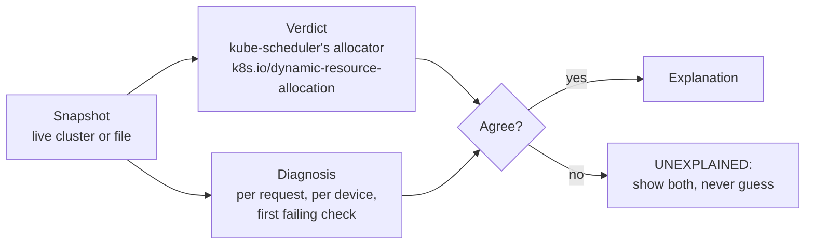

# claimcheck

**Explains why Kubernetes can't allocate a GPU to your pod.**

`kubectl claimcheck` replays the scheduler's own [Dynamic Resource Allocation](https://kubernetes.io/docs/concepts/scheduling-eviction/dynamic-resource-allocation/) allocator against your cluster and tells you, device by device, why a `ResourceClaim` can't be satisfied.


```
$ kubectl claimcheck explain pod/llm-train -n ml

pod ml/llm-train  (Pending)

 BLOCKED   No eligible node can allocate the claims (3 nodes checked).

Nodes (allocator verdict · why)
  control-plane   ✗   gpu: no devices
  worker-a        ✗   gpu 0/1 usable · 4 fail selector #0
  worker-b        ✗   gpu 0/1 usable · 2 tainted, 2 fail selector #0

Why
  request "gpu" in ml/llm-train-gpu: needs 1, 0 usable (8 devices considered).
    selector #0 rejects 6 of 8 devices: device.attributes["gpu.example.com"].model == "H100"
        values seen: model=L40S ×6
    2 of 8 devices match but are tainted: taint example.com/maintenance=driver-upgrade:NoSchedule (DeviceTaintRule maintenance-worker-b) ×2
        add a matching toleration to the request, or remove the taint
```

The scheduler's own message for the same pod is `cannot allocate all claims`.

## Why this exists

DRA is how Kubernetes hands out GPUs and other devices. A claim describes the device it needs with CEL selectors, and the scheduler matches those against the devices each node advertises in `ResourceSlices`. When nothing matches, users get one line, `cannot allocate all claims`, with no claim, request, device or reason.

Putting detailed errors into the scheduler was discussed in [kubernetes/kubernetes#137490](https://github.com/kubernetes/kubernetes/issues/137490). It was ruled out because of the cost of keeping every rejection reason. The suggestion there was:

> *"a more promising approach is to let users simulate allocation with a tool that they run locally."*

claimcheck is that tool. Kubernetes v1.37 adds CEL-derived attributes, list-type attributes, device compatibility groups and GA device taints, so there are more ways for a claim to silently not match.

## How it works



- **The verdict comes from the real allocator.** claimcheck imports the same `structured` allocator package kube-scheduler runs and calls it for every node. "Fits" or "doesn't fit" is the scheduler's answer, not an approximation.
- **The reasons come from a diagnostic pass.** The allocator only returns nil when nothing fits. claimcheck re-checks every device against every request in the allocator's order:
  - device class selectors, then request selectors
  - per-device node selection
  - already allocated
  - feature gates
  - device taints

  It uses the allocator's own CEL compiler, node matcher and toleration logic, then checks whether the requests compete for the same devices (bipartite matching, including `firstAvailable` fallbacks).
- **The two must agree.** If the diagnosis disagrees with the allocator on a node, claimcheck reports `UNEXPLAINED` and shows both answers instead of a plausible but wrong reason. A randomized test asserts this agreement on thousands of generated clusters.

## What it explains

| Situation | What you see |
|---|---|
| A CEL selector rejects devices | the failing expression, plus the actual values it read: `values seen: memory=40Gi ×6` |
| A DeviceClass selector rejects devices | same, attributed to the class |
| A selector errors at runtime (missing attribute) | the error, and that the scheduler fails the whole pod for it |
| Matching devices are held by other claims | which claims hold them |
| Matching devices are tainted | the taint and the `DeviceTaintRule` it came from |
| Not enough devices / `allocationMode: All` | needed vs usable, per node |
| Requests compete for the same devices | which requests, which devices |
| `firstAvailable` alternatives all fail | each alternative's reason |
| `matchAttribute` / `distinctAttribute` can't be met | the constraint, with usable devices grouped by value: `nvlink=domain-a: gpu-0 · nvlink=domain-b: gpu-2` |
| A GPU partition's physical device is used up | the shared counter it needs, what's left, and which partitions hold it |
| Partitions fit one at a time but not together | the counter set they exceed together |
| A shared device's capacity is used up | what the request needs, what's left, and which claims share it |
| A capacity request breaks the device's policy | the rounded value and the policy (`min 1G, max 8G, step 1G`) |
| An `allocationMode: All` device breaks a constraint | that the allocator stops with an error instead of backtracking |
| DeviceClass doesn't exist | the scheduler-level error |
| It would fit, but on a node the pod can't use | the node and the `nodeSelector` or pinned claim that rules it out |
| Driver not publishing devices | no devices visible for the class on any node |

## Install

```sh
go install github.com/asaleem9/claimcheck/cmd/kubectl-claimcheck@latest
```

With `kubectl-claimcheck` on your `PATH`, kubectl picks it up as `kubectl claimcheck`. A krew package is published with each release.

claimcheck is read-only. It needs `list` on nodes, pods, and `resource.k8s.io` DeviceClasses, ResourceSlices, ResourceClaims and DeviceTaintRules.

## Usage

```sh
# Why is this pod Pending?
kubectl claimcheck explain pod/llm-train -n ml

# Every device on every node, and machine-readable output
kubectl claimcheck explain pod/llm-train -n ml --devices
kubectl claimcheck explain pod/llm-train -n ml -o json

# A standalone claim: where would it fit right now?
kubectl claimcheck explain resourceclaim/shared-gpu -n ml

# Can every member of a gang-scheduled PodGroup get its devices at once?
kubectl claimcheck explain podgroup/train-gang -n ml
```

### What would change it

```sh
# Which single change (freeing one claim, removing one taint rule) would let it fit?
kubectl claimcheck whatif pod/llm-train -n ml --suggest

# Before and after, without touching the cluster
kubectl claimcheck whatif pod/llm-train -n ml --free pod/finetune
kubectl claimcheck whatif pod/llm-train -n ml --remove-taint-rule driver-upgrade-worker2

# Would this claim fit right now, and where?
kubectl claimcheck whatif -f claim.yaml -n ml
```

```
pod ml/llm-train  BLOCKED   tried 2 single changes

  Any one of these would let it fit:
    free ResourceClaim ml/finetune-gpus-vz6tj       holds 6 devices in claimcheck-worker   → fits on claimcheck-worker
    remove DeviceTaintRule driver-upgrade-worker2                                          → fits on claimcheck-worker2
```

### Capacity and fragmentation

```sh
kubectl claimcheck pools            # every pool: in use, shared, tainted, blocked, free
kubectl claimcheck pools --devices  # plus each device's holder or reason
```

```
worker · pool worker  gpu.example.com
  ██▒▒▒▒▒▒▒░░░░░  2 in use · 7 blocked · 5 free
  gpu-0 memory   █████░░░░░░░░░░░░░░░   20Gi of 80Gi used · largest free partition 40Gi
  gpu-1 memory   ████████████████████   80Gi of 80Gi used
```

"Blocked" partitions are free but can't be allocated, because sibling partitions of the same GPU use up the shared counters. That's GPU fragmentation, and no `kubectl get` output shows it.

### Offline and in bug reports

```sh
# Capture the cluster's DRA state once, explain anywhere (bug reports, CI, demos)
kubectl claimcheck snapshot -f cluster.yaml
kubectl claimcheck explain pod/llm-train -n ml --from cluster.yaml

# Feature gates can't be read through the API; v1.37 defaults are assumed
kubectl claimcheck explain pod/x --features DRADerivedAttributes=true
```

Try it without a cluster:

```sh
make demo   # explains testdata/scenarios/all-in-use/snapshot.yaml
```

## Scope and limitations

claimcheck explains DRA allocation. It doesn't re-run every scheduler filter. Node eligibility covers `spec.nodeName`, `nodeSelector`, and claims already pinned to a node, but not affinity, taints on nodes, or resource fit.

The diagnosis models the stable and beta parts of DRA in v1.37: selectors, taints, `firstAvailable`, constraints, partitionable devices and consumable capacity. It doesn't yet model these alpha features, and reports `UNEXPLAINED` when they decide the outcome:

- CEL-derived attributes
- list-typed attributes
- device compatibility groups

## Development

```sh
make test       # unit, golden-file and randomized agreement tests
make golden     # accept intended output changes
make lint

make e2e-up     # kind on Kubernetes v1.37 + dra-example-driver (8 mock GPUs per node, no hardware)
make e2e        # make kube-scheduler reject real pods, assert claimcheck says why
make e2e-down
```

Each scenario in `testdata/scenarios/` has a `snapshot.yaml` and its expected `explain.golden` output. The end-to-end scenarios in `test/e2e/scenarios/` run against a real scheduler. Each one waits until kube-scheduler marks the pod unschedulable, then asserts claimcheck's verdict and reason.

## Roadmap

- [x] `explain` for pods and claims, `snapshot`, offline `--from`
- [x] `matchAttribute` / `distinctAttribute`, partitionable devices and shared counters, consumable capacity
- [x] `whatif`, including `--suggest` for the single change that would make it fit
- [x] `pools`: free, used, tainted and fragmented devices per pool
- [x] `explain podgroup/…` for gang-scheduled workloads (Workload / PodGroup API, beta in v1.37)
- [ ] CEL-derived attributes, list-typed attributes and device compatibility groups (alpha in v1.37)
- [ ] Partitionable-device and gang scenarios in the end-to-end suite

## License

Apache 2.0
